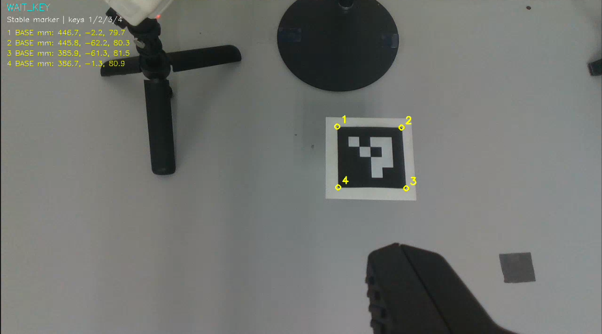

# reBot Eye Calibration

[中文文档](README.md)

Real-robot eye-in-hand and eye-to-hand calibration for the reBot B601-RS, with automatic/manual data acquisition, independent validation and keyboard-selected ArUco corner alignment.



- **Eye-in-hand:** wrist-mounted camera, stationary calibration target; estimates `T_gripper_camera`.
- **Eye-to-hand:** stationary external camera, rigid target on the moving gripper during calibration; estimates `T_base_camera`.
- Reuses the official SDK, Pinocchio, OpenCV and a pinned upstream MotorBridge snapshot runtime. Local SDK compatibility extensions are explicitly recorded.
- Known-size ArUco pose estimation needs RGB only. General pixel-to-3D picking additionally needs depth, a known plane, or another geometric constraint.
- Optional effective joint2–5 angle corrections are paired with each extrinsic. They are not verified encoder-zero or complete geometric calibration.

```bash
git clone https://github.com/goatwzz/rebot-eye-calibration.git
cd rebot-eye-calibration
conda env create -f environment.yml
conda activate rebot-calibration
python tools/bootstrap_sdks.py
python tools/verify_release.py
python tools/run_offline_checks.py
```

See the [installation guide](docs/INSTALLATION.md), [complete workflow](docs/WORKFLOW.md), [architecture](docs/ARCHITECTURE.md) and [results](docs/RESULTS.md).

After configuring and validating your own hardware, run either demo from its own subdirectory:

```bash
cd rebot_eye_in_hand
python scripts/aruco_corners_eih.py             # camera-only preview
python scripts/aruco_corners_eih.py --execute   # real robot motion
```

```bash
cd rebot_eye_to_hand
python scripts/aruco_corners_eth.py
python scripts/aruco_corners_eth.py --execute
```

Keys `1`–`4`: reset, detect, approach selected corner. Wrist reset returns to the observation pose; external reset returns to raw home. `r`: reset only. `h`/Space: cancel and hold. `q`/Esc: request normal home and hold. Explicit terminal `release` requests disable after physical support.

**Sample parameters belong to one installation. Do not reuse them for another camera mounting.** Model FK convergence does not establish physical fingertip accuracy. Independent fixed-target validation still fails the configured acceptance criteria: wrist translation RMS 2.783 mm, external 2.603 mm. No submillimetre physical accuracy is claimed.

Automatic pose preflight is not full environment collision detection. Keep the workspace clear, run only one motor controller, and use physical stopping provisions. Software hold depends on functioning power/communication.

Project-owned code: MIT. SDK and other dependencies retain their upstream terms; see [third-party notices](THIRD_PARTY_NOTICES.md).
