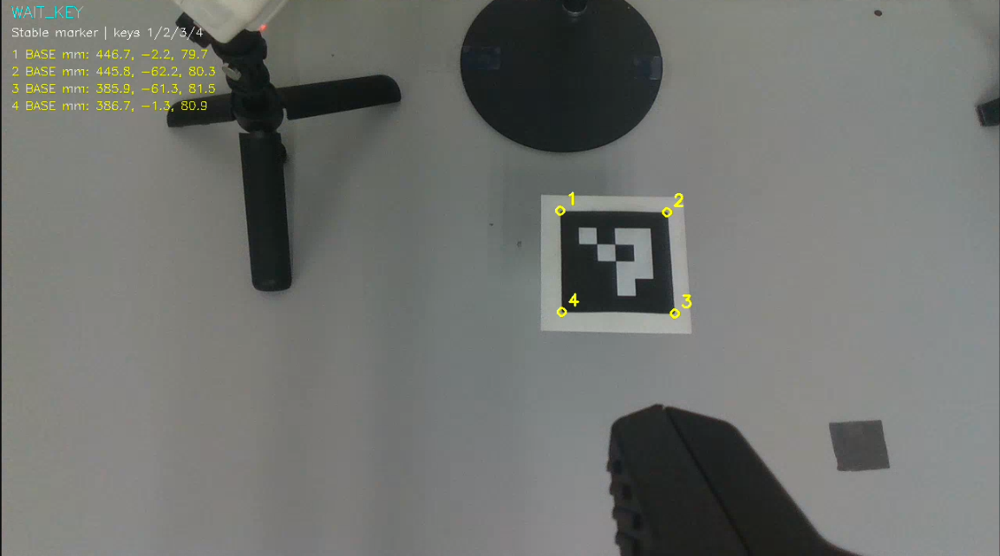
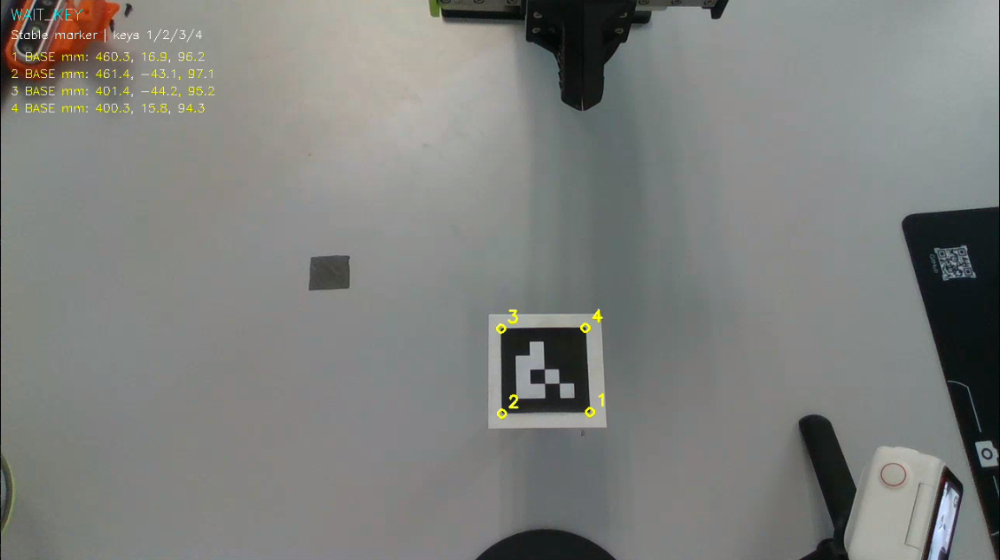
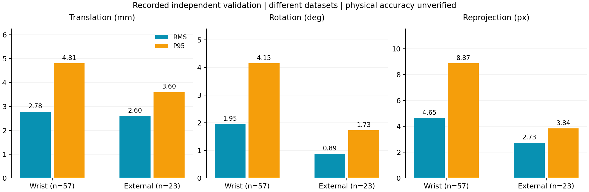

<div align="center">

# reBot Eye Calibration

**reBot B601-RS 实机手眼标定与 ArUco 四角对准演示**

眼在手上 · 眼在手外 · 自动采集 · 手动拖动 · 独立验证

[English](README.en.md) · [安装](docs/INSTALLATION.md) · [完整复现](docs/WORKFLOW.md) · [标定结果](docs/RESULTS.md) · [控制与坐标系](docs/ARCHITECTURE.md)

</div>

把相机看到的 ArUco 角点转换到机械臂基座坐标系，再用真实机械臂的指尖对准。项目覆盖两种相机安装方式，复用 reBot 官方 SDK 与 Pinocchio，实现从采集、拟合到实机展示的完整流程。

| 眼在手上 Eye-in-Hand | 眼在手外 Eye-to-Hand |
|---|---|
| 相机安装于腕部，标定时码板固定在桌面 | 相机固定于外部，标定时码板刚性安装于末端 |
| 求 `T_gripper_camera` | 求 `T_base_camera` |
| 演示中每次选角点先回观察位，再识别与接近 | 演示中每次选角点先回零，再识别与接近 |

<table>
<tr>
<td width="50%"></td>
<td width="50%"></td>
</tr>
<tr><td colspan="2" align="center">真实实验界面。数字1～4随码板方向旋转，是检测到的码板角点顺序；BASE mm显示模型转换后的基座坐标。截图用于展示操作，不作为精度证明。</td></tr>
</table>

## 能做什么

- 固定尺寸 ArUco 的 RGB/PnP 位姿估计，支持显式相机序列号与内参检查。
- 自动遍历多组位置、俯仰及多轴旋转，停稳后保存图像与实测关节反馈；支持中断后补采。
- 手动重力补偿拖动采集：停稳后按 Enter 保存一组。
- 外参拟合、鲁棒角点重投影优化，以及可选的第2～5轴有效角度修正。
- 独立验证与位姿覆盖检查，区分训练误差、验证误差、FK到位误差和实测指尖误差。
- 按 `1/2/3/4` 选择四角，优先选择末端向下姿态，用 SDK 轨迹/CLIK 接近，支持模型笛卡尔外环。
- 另保留 RGB-D 鼠标点击悬停演示。ArUco标定/角点演示只需RGB；任意像素抓取需要深度或已知平面等额外几何约束。

## 硬件与软件

测试平台为 Linux x86_64、Python 3.10、reBot B601-RS（RobStride RS电机）、SocketCAN `can0`、RealSense D435。腕部与外置相机分别绑定自己的序列号。模型参考帧为 `base_link` 与 `gripper_end`。

使用 [Seeed reBotArm SDK](https://github.com/Seeed-Projects/reBotArm_control_py)、Pinocchio、OpenCV、SciPy 和 RealSense SDK。SDK包含本地兼容扩展；固定提交、补丁、MotorBridge快照依赖均有记录，详见[第三方声明](THIRD_PARTY_NOTICES.md)。

## 快速开始

```bash
git clone https://github.com/goatwzz/rebot-eye-calibration.git
cd rebot-eye-calibration
conda env create -f environment.yml
conda activate rebot-calibration
python tools/bootstrap_sdks.py
python tools/verify_release.py
```

`bootstrap_sdks.py` 只下载和准备依赖，不连接相机/CAN、不使能电机。Linux可能还需安装图形库、RealSense设备规则与CAN驱动，见[安装说明](docs/INSTALLATION.md)。

仓库里的外参和相机内参是**作者特定安装的示例**。更换相机、移动基座/相机、重新安装腕部相机，或者更换TCP定义后，需要重新标定。不要把修改相机序列号当成标定。

离线检查：

```bash
python tools/run_offline_checks.py
```

角点演示仅预览，相机启动但机械臂不使能：

```bash
cd rebot_eye_in_hand
python scripts/aruco_corners_eih.py
# 或者另开一次进程：
cd ../rebot_eye_to_hand
python scripts/aruco_corners_eth.py
```

完成本机配置、标定与验证后，分别在对应子目录运行实机：

```bash
# 腕部相机
python scripts/aruco_corners_eih.py --execute
# 外置相机
python scripts/aruco_corners_eth.py --execute
```

| 按键 | 行为 |
|---|---|
| `1/2/3/4` | 先回位，再识别并接近对应角点；运动中不接受角点切换 |
| `r` | 腕部回观察位；外置回RAW零位 |
| `h` / 空格 | 取消当前运动并保持 |
| `q` / Esc | 正常退出时请求回RAW零位，随后保持 |
| 终端 `release` | 操作者托稳后明确请求失能 |

**上电运动前清空路径，只运行一个电机控制器。** 自动预检检查工作区、关节和动力学限制，不是完整的环境碰撞规划。程序故障时请求停止运动并保持；供电或通信断开时，软件无法保证保持。正常退出也不会在未收到明确 `release` 前自动失能。

## 标定、验证与教学复现

完整的实机布置、采集、补采、拟合、独立验证以及指尖实测方法见 [WORKFLOW.md](docs/WORKFLOW.md)。

```bash
# 腕部自动采集：码板固定桌面，相机随手运动
cd rebot_eye_in_hand
python scripts/collect_handeye_eih_auto.py --plan-only --output runs/plan_01
python scripts/collect_handeye_eih_auto.py --execute --output runs/train_01
python scripts/collect_handeye_eih_auto.py --execute --split validation --output runs/validation_01
python scripts/fit_handeye_eih_paired.py \
  --dataset runs/train_01 --validation-dataset runs/validation_01 \
  --output runs/candidate_01
```

```bash
# 外置自动采集：相机固定，码板刚性固定末端
cd rebot_eye_to_hand
python scripts/collect_handeye_eth_auto.py --plan-only --output runs/plan_01
python scripts/collect_handeye_eth_auto.py --execute --output runs/train_01
python scripts/collect_handeye_eth_auto.py --execute --split validation \
  --config auto_validation_config.json --output runs/validation_01
python -m eyehand identify-kinematics --dataset runs/train_01 --output runs/candidate_01
python -m eyehand validate --result runs/candidate_01/result.json \
  --dataset runs/validation_01 --output runs/validation_report_01.json
```

这两套默认采集配置对应不同实物负载，不能直接互换。腕部自动采集配置对应两根夹指已拆、相机110g；指尖演示需要装回夹指。外置采集对应腕部相机已移除、末端保留16g码板；外置角点演示码板在桌面、末端码板负载为0。详细配置位置见复现文档。

## 已记录的结果

| 指标 | 腕部相机 | 外置相机 |
|---|---:|---:|
| 拟合样本 | 74 | 61 |
| 独立验证样本 | 57 | 23 |
| 训练平移RMS | 2.592 mm | 2.013 mm |
| 验证平移RMS / P95 | 2.783 / 4.809 mm | 2.603 / 3.604 mm |
| 验证旋转RMS / P95 | 1.955° / 4.153° | 0.887° / 1.733° |
| 验证重投影RMS / P95 | 4.646 / 8.874 px | 2.734 / 3.836 px |
| 验证状态 | FAIL_CONSISTENCY | FAIL |



两组验证使用不同数据和覆盖范围，不能当作严格的相机优劣对比。固定靶标一致性不是指尖绝对定位精度，目前也没有宣称亚毫米物理精度。完整矩阵、关节修正、模型间隙及局限见 [RESULTS.md](docs/RESULTS.md)。

当前作者实验设置：腕部角点上方 **3 mm**，外置角点上方 **0.5 mm**。这是模型指令间隙，小于或接近已知误差，可能实际触板；首次复现应先用较大间隙并实测，再逐步接近。

## 目录

```text
rebot-eye-calibration/
├── rebot_eye_in_hand/       # 腕部入口、业务、重力拖动适配、配置及测试
│   ├── scripts/
│   ├── wrist/
│   ├── robot/
│   └── config/
├── rebot_eye_to_hand/       # 外置入口和两者共用的后端
│   ├── scripts/
│   ├── eyehand/            # 几何、采集、SDK适配、反馈与演示状态机
│   ├── runtime/            # 校验过的MIT MotorBridge快照依赖
│   └── targets/
├── examples/               # 示例参数、验证报告；不是通用实机参数
├── docs/                   # 安装、复现、控制链、结果和截图
├── tools/                  # 依赖准备、本地配置、离线检查
└── vendor/                 # SDK版本与兼容补丁，下载的SDK本身忽略提交
```

原始采集照片、运行日志、机器环境、SDK完整副本和历史备份未纳入源码仓库。发布过程不改动作者正在运行的实机目录。

## 许可证与致谢

项目自有代码采用 [MIT](LICENSE)。感谢 Seeed reBotArm、MotorBridge、Pinocchio、OpenCV 与 librealsense。第三方来源、版本、许可范围见 [THIRD_PARTY_NOTICES.md](THIRD_PARTY_NOTICES.md)。
