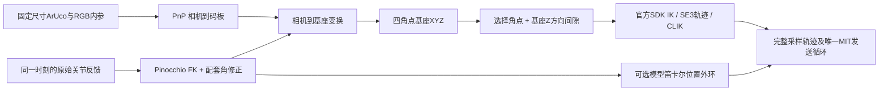

# 坐标系、控制链与目录职责

## 两种标定的方程

统一约定：`T_A_B`把B系坐标转换到A系，平移单位为米，角度内部用弧度。`base_link`是URDF根坐标，`gripper_end`是末端参考坐标，camera使用RGB光学坐标。

眼在手上，固定码板：

```text
T_base_target = FK(q_raw + offsets) × T_gripper_camera × T_camera_target
```

眼在手外，码板刚性安装于末端：

```text
T_base_camera × T_camera_target = FK(q_raw + offsets) × T_gripper_target
```

相机到基座的变换必须按方向使用，不能把`T_camera_base`直接拿来左乘相机点。腕部相机还需要图像时刻对应的实测关节角；不能用目标关节角替代。

## 角点演示



码板可以架高。已知黑框真实尺寸和内参后，PnP可以恢复包含高度的三维位姿，不需要深度。角点目标沿**基座+Z**加高，不是沿码板法线；码板倾斜时四个角的Z可能不同。

向下姿态按90、75、60、45、30、15度顺序尝试，选可达且满足配置的姿态。不是无条件垂直向下，也不能只检查TCP点就断言整个夹爪不会碰板。

角点按检测器返回的码板顺序编号。码板转动后，图像左上角不一定是1号，见README两张截图。

## 规划、通信与外环

`eyehand.sdk_hover`与`sdk_transit`复用SDK轨迹/CLIK和回零轨迹。规划、图像与UI任务不直接各自给电机发目标，电机目标由共享控制循环发送。配置标称机械臂500Hz、夹爪保持50Hz；实际频率需要检查运行日志，不能把配置频率当成实测。

`native_feedback`读取MotorBridge公开的`get_state_snapshot()`：位置、序列号和反馈年龄来自原生状态。不能把缓存读取时间伪装为新的电机反馈。相机与机器人数据还需检查同步/静止窗口。

`cartesian_settle`对目标或轨迹参考与模型FK之间的XYZ差值作有限速、滤波和幅度限制的修正。`--outer-loop settle`仅在末端收敛阶段使用外环，便于对比抖动来源；默认策略以运行配置和CLI为准。

外环没有测量真实指尖，无法消除错误外参、TCP定义或连杆模型造成的物理偏差。FK误差很小而指尖仍偏离，首先检查这些模型和视觉链。

`q_model = q_raw + offsets`。相机链、FK、IK和重力计算配套使用，发给电机的仍是RAW坐标；不能把偏置写进电机零点，也不能在修正后的URDF上再叠加一次偏置。

## 采集与演示的区别

自动采集使用名义URDF及RAW角度，不把旧外参或拟合修正当作新测量真值；关闭跟踪外环。停稳后保存PNG，再原子提交dataset.json，已经提交的样本在后续中断时仍存在。

图像识别失败与通信故障不同。腕部配置`max_consecutive_capture_failures=0`表示连续未识别不自动暂停；每姿态等待8秒后跳过。通信/相机故障仍停止自动流程并保持。

## 代码职责

| 路径 | 职责 |
|---|---|
| `rebot_eye_in_hand/scripts` | 腕部采集、验证、拟合、演示入口 |
| `rebot_eye_in_hand/wrist` | 腕部坐标链、验证和SDK适配 |
| `rebot_eye_in_hand/robot` | 复用原手动重力拖动控制器 |
| `rebot_eye_to_hand/eyehand/geometry.py` | SE3、OpenCV初值、重投影优化与误差计算 |
| `eyehand/kinematics.py` | 名义/修正FK与有效角修正辨识 |
| `eyehand/auto_collection*` | 采集计划、落盘、恢复及状态机 |
| `eyehand/corner_*` | 角点识别稳定性、回位与接近流程 |
| `eyehand/hover_control.py` | SDK发送、反馈及保持流程 |
| `runtime` | 已固定来源、许可证和哈希的第三方MotorBridge快照运行时 |
| `vendor/sdk-*` | SDK精确版本、部署兼容补丁和扩展来源 |

控制故障通常不能通过放宽反馈年龄阈值来解释或修复；先对比真实序列号增长、最慢反馈年龄、发送频率和线程耗时。原始故障日志是诊断证据，本发布包不包含作者历史会话日志。
