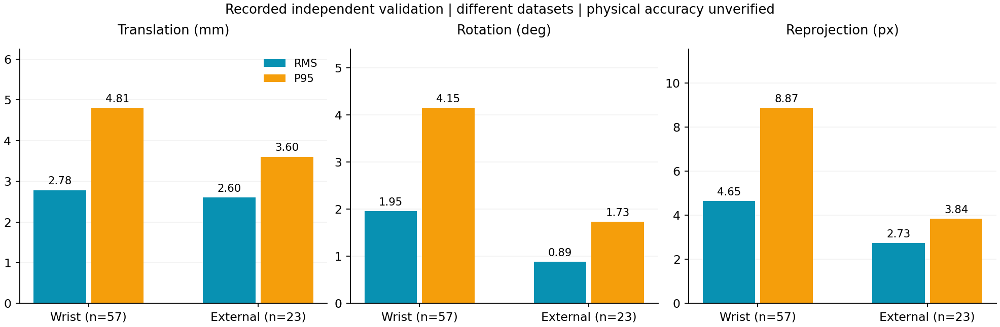

# 当前示例标定结果（2026-11-25）

这些参数来自作者同一台reBot的特定安装，不是B601-RS的出厂通用外参。更换安装后不能直接套用。角修正属于有效模型参数，不是已验证编码器零偏。

## 腕部相机

相机序列号`332322072170`，74组100mm码训练。当前演示码板为60mm ID0。
`T_gripper_camera`将相机点变换到gripper_end，平移单位m：

```text
[-0.001977622, -0.514150948,  0.857697436, -0.111131351]
[-0.999981633, -0.003897095, -0.004641824,  0.033698005]
[ 0.005729126, -0.857690862, -0.514133798,  0.095592993]
[ 0.000000000,  0.000000000,  0.000000000,  1.000000000]
```

第1～6轴修正(deg)：`[0.0, 2.452577744, -0.108937908, -1.751220033, -0.531771548, 0.0]`。

数据文件：[NPZ](../examples/calibration/eye_in_hand/hand_eye.npz)，[57组验证报告](../examples/calibration/eye_in_hand/validation_report.json)。NPZ同时保存外参和配套角修正。

## 外置相机

相机序列号`250122070127`，61组60mm码训练。
`T_base_camera`将相机点变换到base_link，平移单位m：

```text
[-0.000805703,  0.961171455, -0.275950692,  0.517967258]
[ 0.999800597,  0.006280278,  0.018955858, -0.045178362]
[ 0.019952876, -0.275880394, -0.960984855,  0.583438084]
[ 0.000000000,  0.000000000,  0.000000000,  1.000000000]
```

第1～6轴修正(deg)：`[0.0, 1.775366476, 1.305695454, -2.744558149, -0.897969782, 0.0]`。

数据文件：[结果JSON](../examples/calibration/eye_to_hand/result.json)，[23组验证报告](../examples/calibration/eye_to_hand/validation_report.json)。发布包仅将原模型路径改为可移植的repo引用，矩阵和角修正未变；JSON文件字节哈希因此不同于作者原文件。

## 独立验证

| 指标 | 腕部（57组） | 外置（23组） |
|---|---:|---:|
| 平移RMS | 2.783mm | 2.603mm |
| 平移P95 / 最大值 | 4.809 / 6.389mm | 3.604 / 3.621mm |
| 旋转RMS / P95 | 1.955 / 4.153° | 0.887 / 1.733° |
| 重投影RMS / P95 | 4.646 / 8.874px | 2.734 / 3.836px |
| 状态 | FAIL_CONSISTENCY | FAIL |



两套数据集与姿态分布不同，图示仅汇总记录，不是同条件性能比赛。腕部验证X/Y/Z方向RMS分别为0.751/1.241/2.375mm，低位大俯仰仍存在泛化问题。

这类验证衡量固定靶标的跨姿态一致性。腕部在不知道验证码板绝对位姿时，会估计一个固定均值作一致性参考；它不能证明相机/机器人在物理世界中的全局准确性。

## 目标间隙与控制误差

- 腕部当前目标：识别角点Z＋3mm。
- 外置当前目标：识别角点Z＋0.5mm，固定Z补偿0。
- 两者均沿base_link的+Z方向，而不是码板法向。
- 模型FK误差小不代表指尖间隙真实准确；特别是0.5mm小于已观察到的模型误差，可能触板。
- 原始74组腕部训练主要为中高位及30～59°向下姿态，不能凭训练总误差推断85mm低位、90°姿态的准确度。

当前未提供量具测得的逐角物理指尖误差，不宣称亚毫米或零误差。建议固定同一码板与安装，分别测量多个俯仰下的XY偏差和真实间隙，另做重复定位实验。

## 原始证据与发布范围

公开包保留选用参数、验证数值、SDK版本和复现命令，未上传完整原始图像及历史控制日志。因此可重跑算法/采集并读取这些报告，但不能只靠本仓库重建作者所有历史样本的每个数值。训练后新的候选也不应覆盖这些已发布示例。
